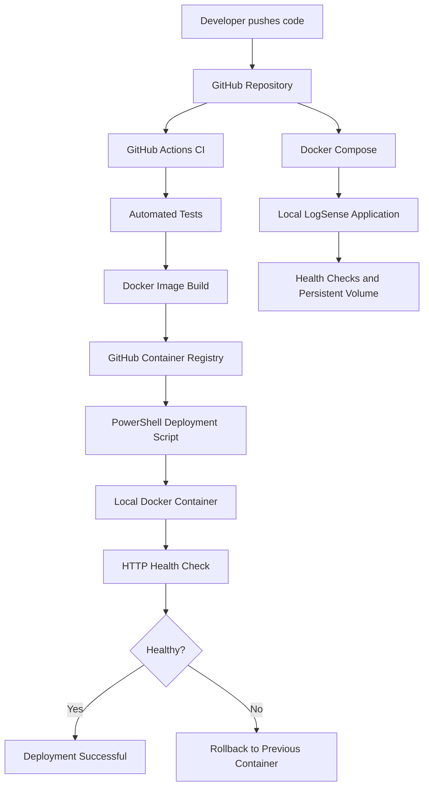
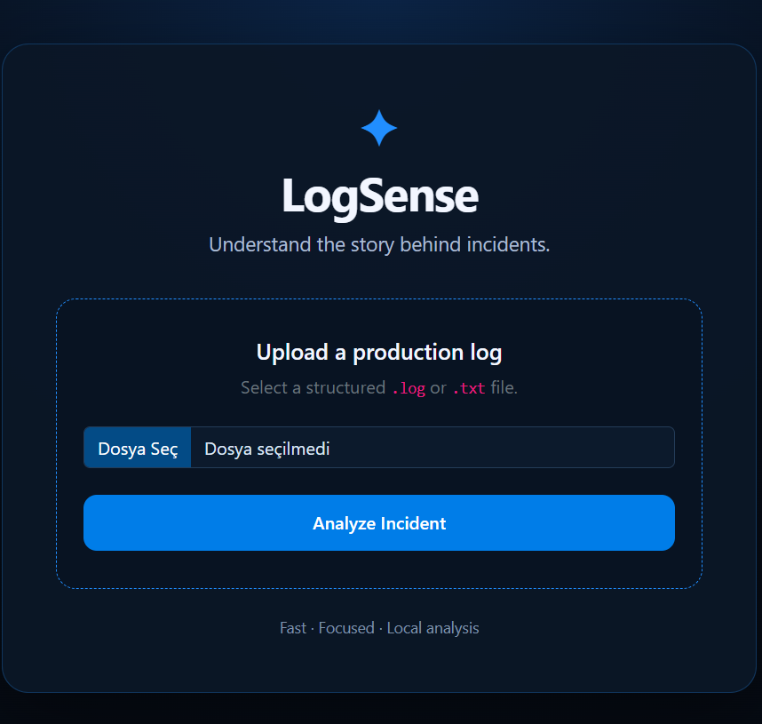
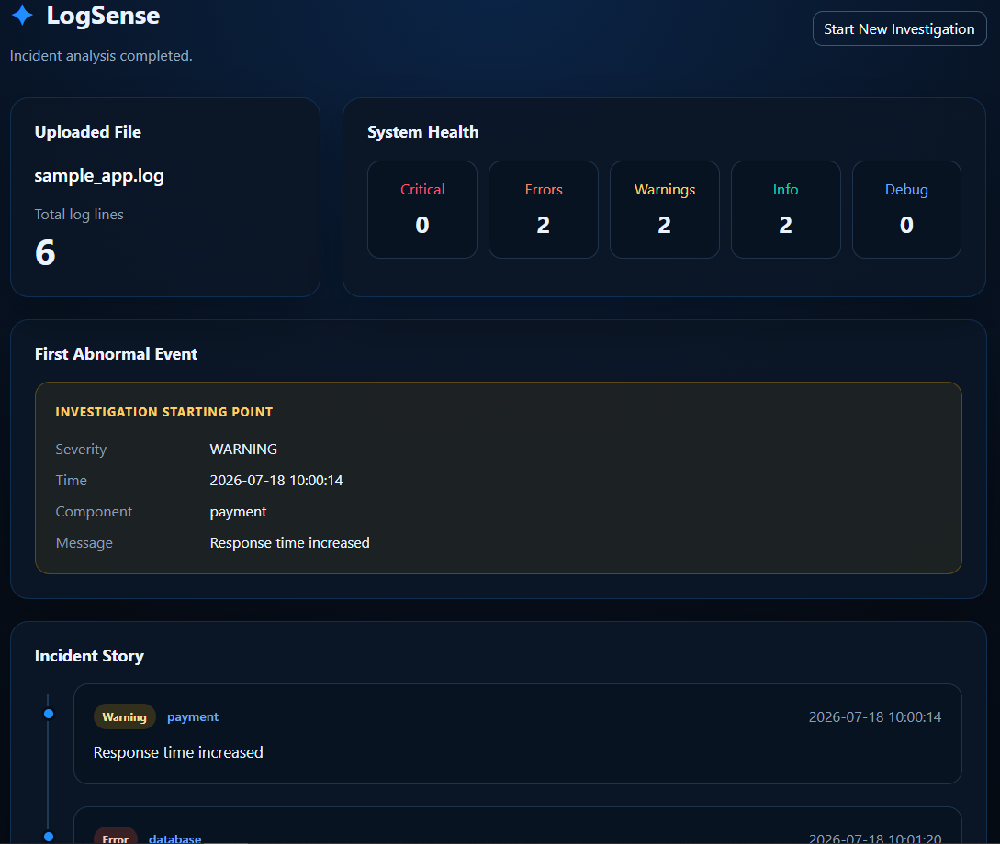
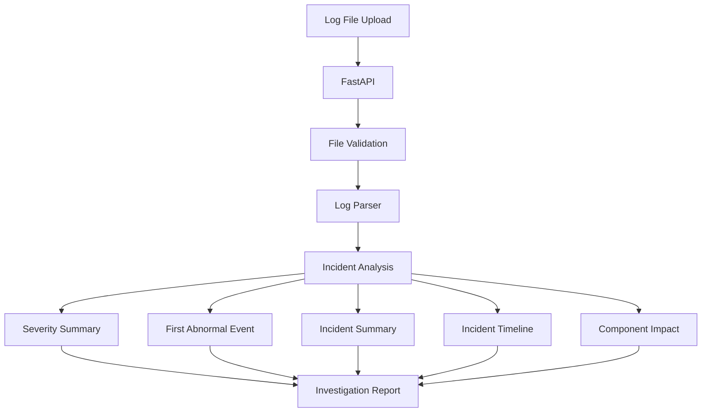

# 🔍 LogSense — Log Analysis & Incident Investigation

### Understand Incidents Faster

LogSense is a web application designed to help Operations, SRE, and DevOps engineers investigate production incidents faster by transforming raw log files into a clear, structured incident analysis.

Instead of searching through thousands of log lines, LogSense identifies abnormal events, highlights where an incident began, tracks how it evolved, and shows which components were affected.

---

## 🚀 Why LogSense?

During production incidents, engineers often need to answer questions such as:

* Where did the incident start?
* Which component was affected first?
* What failures happened next?
* Which components generated the most abnormal activity?
* Did the system recover?

Traditional log analysis often requires engineers to manually search through large volumes of raw log data.

LogSense focuses on helping engineers quickly understand the sequence and scope of an incident so they can begin investigation faster.

---

## ✨ Current Features

### 🔍 Log Analysis
- Upload and validate `.log` and `.txt` files
- Streaming log-file processing
- Severity classification: Critical, Error, Warning, Info, and Debug
- First abnormal event detection
- Incident summary, including start time, component, severity, and status
- Incident timeline covering failures, warnings, and recovery events
- Component impact analysis
- Recovery detection

### 🎨 User Interface
- Dark-themed web interface
- Visual incident summaries and analysis results

### 🐳 DevOps & Automation
- Docker containerization with non-root execution
- Docker Compose configuration for local deployment
- Environment variable configuration
- Automated container health checks
- Persistent Docker volume configuration
- GitHub Actions CI with automated testing
- Docker image publishing to GitHub Container Registry (GHCR)
- Locally tested deployment and automatic rollback using PowerShell

## 🛠️ Technology Stack

* Python
* FastAPI
* Uvicorn
* Jinja2
* HTML
* Bootstrap 5
* Docker
* Git
* GitHub Actions

---


## 🐳 Quick Start with Docker Compose

### Prerequisites

- Git
- Docker Desktop or Docker Engine with Docker Compose

### 1. Clone the repository

```bash
git clone https://github.com/brcsln/LogSense.git
cd LogSense
```

### 2. Build and start LogSense

```bash
docker compose up -d --build
```

### 3. Open the application

Visit http://localhost:8002

Upload a supported `.log` or `.txt` file to explore the incident analysis.

### 4. Check application health

```bash
docker compose ps
```

The LogSense container should report `healthy`.

To inspect application logs:

```bash
docker compose logs --tail=20
```

### 5. Stop LogSense

```bash
docker compose down
```

Docker Compose preserves the named volume when stopping and removing the container.

### Container configuration

The Compose setup includes:

- Non-root application execution
- Automatic HTTP health checks
- Environment variable configuration
- Container restart policy
- Named Docker volume mounted at `/app/data`

**Note:** The volume provides persistent storage, but application uploads are not yet configured to be saved there.

## 🔄 CI/CD Pipeline

LogSense uses GitHub Actions to automate testing and container image delivery.

### Continuous Integration (CI)

GitHub Actions automatically validates application changes by:

- Installing Python dependencies
- Running automated tests with pytest
- Building the Docker image
- Starting a test container
- Verifying that the application responds successfully to an HTTP request

The pipeline helps detect test failures and container build issues before publishing a new image.

### Container Registry

Docker images are published to GitHub Container Registry (GHCR).

Images are tagged with:
- `latest` for the current published image
- A Git commit SHA for identifying a specific build

Registry:
`ghcr.io/brcsln/logsense`

### Deployment and Rollback

A PowerShell deployment script is available at:

`scripts/deploy.ps1`

The script supports:

- Pulling a selected Docker image
- Preserving the previous container for rollback
- Deploying the requested version
- Checking application health
- Restoring the previous container if deployment fails

The deployment and rollback process has been tested locally.

**Note:** GitHub Actions automates CI and image publishing. Deployment to the local environment is performed separately using the PowerShell script.

## 🏗️ DevOps Architecture

LogSense combines a Python web application with automated testing, container image delivery, and local deployment.



### Key Components

- **Application:** Python and FastAPI power the LogSense backend.
- **CI:** GitHub Actions runs automated tests and validates Docker builds.
- **Container Registry:** GitHub Container Registry stores published Docker images.
- **Deployment:** A PowerShell script manages local deployment, health verification, and rollback.
- **Docker Compose:** Provides reproducible local container configuration, health checks, environment variables, and persistent storage.

Cloud deployment is planned for a future development phase.


## 💻 Local Development

From the `backend` directory, create a virtual environment:

```bash
python -m venv venv
```

Install dependencies:

```bash
pip install -r requirements.txt
```

Run the application:

```bash
python -m uvicorn app:app --reload
```

Then open:

```text
http://127.0.0.1:8000
```


---

## 📸 Screenshots

### Home Page



### Incident Analysis



---


## 🧩 Application Architecture



LogSense processes uploaded log files to identify abnormal events, summarize severity levels, and present incident investigation results.


## 🧭 Roadmap

### ✅ Completed

- Python/FastAPI log analysis application
- Automated parser tests with pytest
- Docker containerization and non-root execution
- Docker Compose with health checks and persistent volume configuration
- GitHub Actions CI pipeline
- Docker image publishing to GitHub Container Registry (GHCR)
- Local deployment automation with health verification and rollback

### 🔨 Next

- Expand automated tests and improve test coverage
- Support additional log formats
- Improve incident correlation and component impact analysis
- Connect application file storage to the persistent Docker volume
- Deploy LogSense to AWS
- Introduce Infrastructure as Code with Terraform

### 🔭 Future

- AI-assisted incident explanations
- Root cause suggestions
- Smart investigation summaries
- Kubernetes deployment and log collection
- Grafana monitoring integration
- Automated cloud deployment

## 💡 Vision

LogSense is not intended to replace engineers.

Its goal is to reduce investigation time by helping engineers quickly understand what happened, where the incident started, which components were affected, and how the incident evolved.

The long-term goal is simple:

> **Help engineers spend less time reading logs and more time solving incidents.**

---

## 👩‍💻 Author

**Burcu Aslan**

Team Lead | Scrum Master | Automation & IT Systems Engineer

Building products that simplify production operations.

**Focus areas:** DevOps, Infrastructure Automation, Site Reliability Engineering, and Python Development.